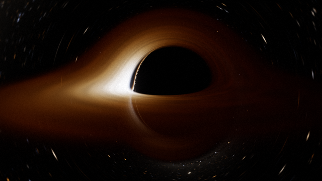

# atlasII — buraco negro com ray tracing de verdade



Simulação de buraco negro (Schwarzschild e Kerr) com disco de acreção. Em vez
de fingir o efeito com um shader bonito, o programa traça o caminho que a luz
faz no espaço-tempo curvo, raio por raio. Sai imagem PNG ou vídeo MP4
(vertical, pra Reels/TikTok, ou horizontal).

Tem duas versões:

- `realtime/index.html`: roda no navegador, na GPU, a 60 fps. É só abrir o
  arquivo (dois cliques), não precisa instalar nada. Dá pra girar a câmera,
  mudar o spin, ligar uma malha do espaço-tempo e arrastar o buraco negro por
  ela, gravar vídeo etc. Detalhes em [realtime/README.md](realtime/README.md).
- `src/blackhole`: o render offline em Python (Numba, float64). É lento, mas é
  o que gera as imagens em alta resolução e serve de referência pra versão
  em tempo real.

## Instalando o render offline

Precisa de Python 3.11+.

```bash
python3 -m venv .venv
.venv/bin/pip install -r requirements.txt
.venv/bin/pip install -e .
```

No Windows troque `.venv/bin/` por `.venv\Scripts\`.

Pro vídeo ele usa o `ffmpeg` do sistema se tiver; se não tiver, cai no
`imageio-ffmpeg` (e avisa).

## Usando

```bash
.venv/bin/python -m blackhole render --preset preview              # 320x180, uns segundos
.venv/bin/python -m blackhole render --preset hd                   # Full HD
.venv/bin/python -m blackhole render --preset video                # vertical 1080x1920, 15 s
.venv/bin/python -m blackhole render --preset video --landscape    # horizontal
.venv/bin/python -m blackhole render --preset preview --spin 0.9   # girando (Kerr)
.venv/bin/python -m blackhole bench --preset video                 # só estima o tempo
```

Outras opções: `--threads N`, `--scale 0.25`, `--frames 10`,
`--inclination 75`, `--r-cam 30`, `--fov 60`, `--temp 6500`, `--r-out 20`,
`--aa 3`, `--exposure 0.8`, `--seconds 12`, `--fps 30` e `-y` pra não pedir
confirmação. Tudo vai pra `outputs/`.

Algumas coisas que coloquei pra não fritar o PC:

- usa (núcleos − 2) threads por padrão;
- `hd` e `video` rodam um benchmark rápido antes e perguntam se você quer
  mesmo continuar;
- a imagem é feita em faixas salvas em disco e o vídeo salva cada quadro. Se
  der Ctrl+C, é só rodar o mesmo comando de novo que ele continua de onde
  parou;
- cada raio tem limite de passos, então nada fica em loop infinito.

Pra ter uma ideia: num processador de 12 núcleos o preview leva ~5 s e o vídeo
vertical completo (450 quadros, AA 3x3) leva umas 6–7 horas. Se quiser mais
rápido, `--aa 2`, `--scale 0.5` ou `--seconds 10` ajudam bastante.

Se quiser um céu de verdade no fundo, coloque uma imagem equiretangular (2:1,
tipo um panorama da Via Láctea) em `assets/`. Ela também é distorcida pela
lente gravitacional.

## Testes

```bash
.venv/bin/pytest -q
```

Os testes em `tests/test_physics.py` conferem a física contra os valores
conhecidos: horizonte em r = 2M, esfera de fótons em r = 3M, deflexão da luz
≈ 4M/b (com a correção de segunda ordem), sombra com b = 3√3 M, ISCO em 6M
(e 2,32M com a = 0,9), redshift visto de cima e as bordas da sombra em Kerr.

`tests/test_realtime.py` roda o shader no Chrome headless e compara com o
render offline. Se não tiver Chrome instalado, ele é pulado.

## Como funciona

Unidades com G = c = M = 1, então distâncias são em "massas" (pro Sol,
M ≈ 1,5 km).

As geodésicas são integradas na forma Hamiltoniana, em coordenadas de
Boyer-Lindquist, com RK4 de passo adaptativo (passo pequeno perto do horizonte
e da esfera de fótons). Preferi isso à equação orbital u'' + u = 3u² porque
funciona em 3D e já serve pra Kerr; a equação orbital ficou só como checagem
nos testes. Schwarzschild é o caso a = 0.

A câmera é um observador ZAMO e os raios saem dela pra trás, em direção à
cena. O disco é fino, vai da ISCO até 20M, com T ∝ r^(−3/4). Cada vez que um
raio cruza o plano do disco ele soma emissão, e é daí que aparecem a imagem
secundária e o anel de fótons. A cor vem da lei de Planck passada pelas curvas
CIE, depois tone mapping ACES, bloom e um pouco de grão. O antialiasing é
adaptativo: só faz supersampling nos pixels com borda forte.

## O que você está vendo na imagem

**A sombra.** A mancha preta é maior que o horizonte. Qualquer raio que passe
a menos de 3√3 M ≈ 5,2M do centro é engolido, então a sombra fica uns 2,6x
maior que o horizonte. É ela que o Event Horizon Telescope fotografou em M87*
e Sgr A*.

**O anel de fótons.** Em r = 3M a luz consegue orbitar o buraco negro. Raios
que passam perto disso dão uma ou mais voltas antes de escapar, e formam
aquele fio fino de luz na borda da sombra.

**O disco aparecendo por cima e por baixo.** A gente olha o disco quase de
lado, mas a luz da parte de trás é curvada pela gravidade e passa por cima (e
por baixo) do buraco até chegar na câmera. A faixa fininha de baixo é a imagem
secundária, luz que deu meia volta a mais.

**Um lado mais brilhante.** O gás gira a até metade da velocidade da luz perto
da ISCO. O lado que vem na nossa direção fica mais claro e azulado, o outro
mais escuro e avermelhado (Doppler relativístico + beaming). O brilho escala
com g⁴, então g = 1,3 contra g = 0,7 já dá uns 12x de diferença.

**Redshift gravitacional.** A luz perde energia pra sair do poço gravitacional,
e o gás em órbita rápida tem o relógio mais lento. Resultado: a parte de
dentro do disco parece mais fria do que é. A simulação usa o fator g completo.

**A borda interna do disco.** Abaixo de 6M (sem rotação) não existe órbita
estável, o gás simplesmente cai. Por isso o disco começa na ISCO e não encosta
no horizonte.

**A cor.** O gás esquenta por atrito e brilha como corpo negro, tipo ferro em
brasa. Mais quente puxa pro branco-azulado, mais frio pro laranja.

**Estrelas duplicadas.** O buraco negro funciona como uma lente. Perto da
sombra as estrelas viram arcos, aparecem duas vezes, e quando uma fica bem
atrás vira um anel de Einstein.

**Com spin (`--spin 0.9`).** A rotação arrasta o espaço-tempo junto. A luz que
vai a favor da rotação chega mais perto sem cair, a que vai contra cai antes.
A sombra fica achatada de um lado e a ISCO encolhe pra 2,32M, então o disco
chega mais perto e fica bem mais quente.

**No vídeo.** Cada anel do disco gira na sua velocidade kepleriana (dentro mais
rápido), então as manchas do gás viram espirais. Até o atraso da luz entra:
partes do disco cuja luz demora mais pra chegar aparecem "no passado".

## Organização

```
src/blackhole/
  geodesic.py   métrica de Kerr, Hamiltoniano, RK4 adaptativo
  tracer.py     kernel Numba: câmera, disco, redshift, céu
  color.py      Planck -> RGB
  sky.py        céu procedural ou imagem de assets/
  render.py     tiles, supersampling, retomada
  post.py       bloom, ACES, grão
  pipeline.py   imagem, vídeo, benchmark, ffmpeg
  config.py     presets e trajetória da câmera no vídeo
  __main__.py   CLI
tests/          testes de física (pytest)
realtime/       versão WebGL2 (index.html) + validação e benchmark
outputs/        onde caem as imagens e vídeos
```

Uma pegadinha: o Numba guarda cache compilado por arquivo. Se mexer em
`geodesic.py`, apague `src/blackhole/__pycache__` pro `tracer.py` recompilar.

## Licença

MIT, veja [LICENSE](LICENSE).
